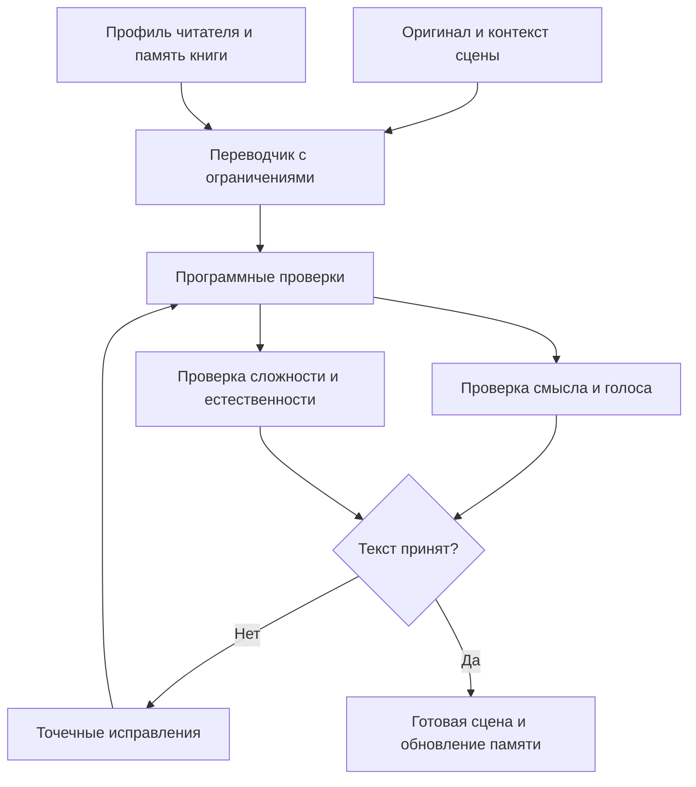

Я хочу использовать hpmor для изучения голладского. Я это представляю себе так, что нужно выстроить какой-то pipeline, который превратит мне исходные тексты в тексты на голландском, которые будет максимально как нормальный литературный перевод, только грамматика будет слегка подтюнена, чтобы соответствовать уровню грамматики A2-B1, не больше.

Я собрала примерный список грамматики тут ./grammar.md

А также нужно разобраться с лексикой, потому что хорошо бы не спотыкаться через каждое слово, потому что очевидно, что литературный перевод будет использовать слова посложнее, даже если они не сильно по смыслу отличаются от слов, которые там уже есть в наборе A2-B1 или типа того. Но также некоторые слова невозможно переписать без потери смысла, тогда допустимо использовать правильный перевод и англ. перевод в скобках.

У меня есть датасеты слов всех, распределённых по уровню djn здесь ../dutch-srs.

Я бы строил это как **литературный перевод с явными ограничениями и циклом проверки**. Один агент отвечает за текст, отдельные проверяющие — за сохранение смысла и доступность языка, а словари и формальные правила проверяются программно.

Главная опасность здесь — получить текст, который проходит проверку на A2–B1, но уже не похож на любимую книгу: исчезли ирония, напряжение, характеры, ритм. Поэтому **качество перевода и простоту нужно оценивать независимо**. Исследования упрощения текстов подтверждают, что улучшение одного показателя может сопровождаться ухудшением другого. [Исследование оценки упрощения](https://aclanthology.org/2024.readi-1.1/)

Вот какую систему я бы предложил.

**1. Сначала превратить твои требования в проверяемый профиль читателя**

«Напиши на A2–B1» — слишком расплывчатая инструкция. CEFR описывает языковые компетенции; конкретные грамматические и лексические перечни требуют отдельной детализации для языка. Поэтому твой список грамматики и датасеты здесь должны стать рабочей спецификацией. [Совет Европы о языковых спецификациях](https://www.coe.int/en/web/common-european-framework-reference-languages/cefr-reference-level-descriptions-language-by-language-components-and-forerunners)

В профиле я бы разделил:

| Компонент | Что задаём |
|---|---|
| Допустимая грамматика | Конструкции из твоего списка, с примерами |
| Запрещённая грамматика | Конкретные конструкции и допустимые способы их переформулировать |
| Сложность предложений | Ограничения на вложенность и сочетание конструкций |
| Базовая лексика | Слова из выбранных уровней |
| Личный словарь | Что ты уже знаешь сверх этих уровней |
| Новая лексика | Сколько незнакомого допустимо и как давать пояснения |

Важный момент: предложение может состоять из разрешённых конструкций, но быть тяжёлым из-за их сочетания. Значит, проверять нужно и отдельную грамматику, и нагрузку предложения целиком.

**Для грамматики можно задать строгий потолок. Для лексики я рекомендую небольшой управляемый запас исключений.** Иначе слова, важные для мира книги, придётся заменять длинными описаниями, которые читаются хуже оригинального слова.

**2. Подготовить «память книги»**

До перевода отдельных фрагментов нужен короткий редакторский справочник:

- имена, обращения, названия и постоянные термины;
- время повествования и точка зрения;
- особенности голоса рассказчика и речи персонажей;
- повторяющиеся образы и выражения;
- решения, которые должны сохраняться между главами.

Например: рассказчик сдержанный; юмор возникает из недосказанности; определённый персонаж отвечает коротко; одно и то же фантастическое понятие всегда переводится одинаково.

Это защищает от ситуации, когда каждая страница хороша сама по себе, но книга звучит так, будто её переводили разные люди.

При этом нужно разделять сведения о книге целиком и сведения, уже доступные читателю: система не должна случайно объяснять загадки раньше автора.

**3. Переводить сценами, сохраняя доступ к оригиналу**

Единицей обработки я бы выбрал сцену или связный фрагмент из нескольких абзацев. Для первого прототипа можно попробовать примерно 500–1000 слов, подстраивая границы под текст.

Отдельное предложение — слишком мало контекста для местоимений, иронии и диалогов. Целая книга — слишком большая единица для точечных исправлений.

Агент-переводчик получает:

- оригинальный фрагмент и небольшой соседний контекст;
- память книги;
- профиль грамматики;
- правила обращения с лексикой;
- краткий список важных для сцены терминов.

Его задача — **сразу написать естественный нидерландский текст внутри ограничений**, сохранив события, детали, интонацию и недосказанность.

Я бы не делал обязательной длинную цепочку «полный перевод → упрощение грамматики → упрощение слов → литературная редактура». При каждом полном переписывании возникает новая возможность потерять нюанс, а литературная редактура может вернуть сложность.

Обычный литературный перевод полезен как дополнительный кандидат для трудных мест и как вариант для сравнения в эксперименте. Но источником истины всегда остаётся оригинал.

**4. Лексику проверять по употреблению, а не по строкам словаря**

Это одна из самых важных частей.

Для нидерландского недостаточно проверить, встречается ли написанное слово в списке:

- `ging` нужно связать с `gaan`;
- `hij stond op` — распознать как употребление `opstaan`;
- устойчивое выражение нужно оценивать целиком;
- знакомое слово может использоваться в незнакомом значении;
- составное слово может отсутствовать в датасете, но быть понятным — или наоборот.

Поэтому сначала нужны лемматизация и языковой разбор, затем сопоставление со словарями. Неоднозначные случаи разбирает модель. **Отсутствие в датасете должно означать «неизвестный статус», а не автоматически «выше B1».**

Для каждого проблемного употребления система выбирает действие:

| Ситуация | Действие |
|---|---|
| Есть простая естественная замена с тем же смыслом | Заменить |
| Проще переформулировать предложение | Переписать предложение |
| Слово важно для атмосферы или будет часто повторяться | Предложить сохранить и пояснить |
| Слово редкое и не несёт существенного оттенка | Предпочесть обычное выражение |
| Простая замена меняет смысл | Зафиксировать конфликт требований |

Например, замена «прошептал» на «сказал» упрощает словарь, но убирает информацию. Решение должно учитывать сцену: иногда подойдёт «сказал очень тихо», иногда лучше сохранить точный глагол.

**Нужно измерять и долю незнакомых употреблений, и количество разных новых слов, и их скопления.** Пять новых слов подряд мешают сильнее, чем пять слов на протяжении страницы.

Как начальную гипотезу для комфортного чтения можно попробовать около 98% знакомых словоупотреблений. Этот ориентир обсуждается в исследованиях чтения на английском; для твоего нидерландского его нужно проверить на практике, а не считать гарантией понимания. И принадлежность слова к A2–B1 сама по себе не означает, что ты его знаешь. [Nation, 2006](https://doi.org/10.26686/wgtn.12552221.v1)

**5. Дать проверяющим разные обязанности**

Я бы начал с трёх агентских ролей. Это могут быть отдельные вызовы одной модели с разными инструкциями; разные модели не обязательны.

**Переводчик-редактор** создаёт текст и вносит исправления. Только он переписывает результат, чтобы сохранялся единый голос.

**Проверяющий смысл и стиль** сравнивает текст непосредственно с оригиналом:

- не исчезли ли события, детали и причинные связи;
- не изменились ли отрицание, степень уверенности, намерения;
- сохранились ли ирония и отношения между персонажами;
- не появились ли объяснения, которых автор намеренно не давал;
- не превратилось ли описание в пересказ.

**Проверяющий язык и доступность** оценивает:

- соответствие конкретным грамматическим правилам;
- сложность слов и выражений в контексте;
- естественность нидерландского;
- тяжёлые сочетания формально допустимых конструкций;
- не стало ли предложение сложнее после замены одного слова длинным объяснением.

Программные проверки дают им список подозрительных мест. Но языковой разбор тоже ошибается, поэтому такой процесс даёт проверяемое соответствие твоему профилю, а не математическую гарантию уровня CEFR.

Выход проверяющего — конкретное замечание: **фрагмент → проблема → основание → требуемое исправление**. Общая оценка «это B1, 8/10» для управления пайплайном почти бесполезна.

**6. Исправлять локально и ограничить число итераций**

Редактор получает замечания и исправляет затронутые предложения или абзацы. После этого проверки выполняются заново: улучшение лексики могло сломать грамматику, а упрощение грамматики — временную последовательность.

Для старта я бы ограничил цикл двумя раундами исправлений. Если конфликт остаётся, система сохраняет лучший вариант и явно отмечает проблемное место. Бесконечный спор агентов обычно означает, что нужно уточнить требования или пересоздать фрагмент из оригинала.

После сборки главы нужна отдельная проверка связности: терминов, обращений, времени повествования, повторов и переходов между сценами.

На выходе — чистый текст для чтения, отдельные пояснения к выбранным словам и внутренний отчёт о проверках.

**7. Сначала проверить архитектуру на небольшом эксперименте**

Я бы не начинал с автоматизации целой книги. Возьми 6–10 характерных фрагментов: диалог, описание, действие, внутренний монолог, юмор, сложный синтаксис.

На них сравни три варианта:

1. Один запрос с твоими правилами.
2. Перевод сразу с ограничениями и проверками.
3. Обычный литературный перевод с последующей адаптацией и теми же проверками.

Оцени отдельно сохранение смысла, удовольствие от чтения, нарушения грамматики и реальные остановки из-за слов. Хотя бы несколько фрагментов полезно проверить с преподавателем или редактором нидерландского. Полезны и вопросы на понимание исходной сцены: они помогают обнаружить смысл, который потерялся при упрощении. Такой подход используется и в исследованиях оценки адаптированных текстов. [Оценка через понимание прочитанного](https://aclanthology.org/2024.tacl-1.24/)

**Мой выбор для первого прототипа — один переводчик, два специализированных проверяющих, словарный анализ и максимум два раунда точечных правок.** Главная работа здесь — сделать твои списки грамматики и лексики хорошей спецификацией и подобрать допустимую нагрузку под твоё чтение. Добавлять новых агентов стоит только под ошибки, которые этот небольшой пайплайн действительно пропускает.